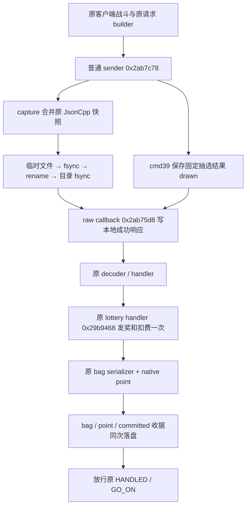

# 15.7.2 离线桥接架构检查与 r12 验收方案

更新时间：2026-10-12。范围：Android ARM64、悟空本地账号、当前 `offline_bridge.js`；不涉及 QQ 业务数据库/API，也不规划联网实现。本次只改本文，不改桥接、测试、存档或 APK。

## 结论

当前实现已具备可复用的本地保存和原生奖励路径，无需为 r12 拆成大型框架。应保留原 JsonCpp 对象、原物品工厂和原属性计算，只对实际失败的协议或状态边界做小修。

r12 暂不能标记完成：700003 的普通通关、翻牌及制作书奖励尚缺本轮实机证据；重复响应只有 Mock 契约测试；未完成领奖在冷启后没有续领路径。后一个问题已从生产代码及同一生产代码的 Node 替身运行中确认，Android 触发窗口仍待验证。

**700003 的 502211 是制作书，不是装备。** 最小装备验收路线是自然领取该书，再走原打造 UI 生成 500201 通风灵戒、佩戴并冷启。无需为了这条路线先增加 700004 装备翻牌。若原打造失败，应记录该真实失败再修复，不能把制作书入包算作装备恢复。

## 当前证据基线

| 证据 | 本次核查 | 可得结论与限制 |
| --- | --- | --- |
| [r11 APK](../artifacts/zmxol-offline/squad-build/15.7.2-gadget-r11.apk) | 文件存在，2,083,968,652 B | 原产物保留；本次没有重新安装或重新做全 APK 签名/CRC 验证 |
| [r11 构建记录](../artifacts/zmxol-offline/squad-build/15.7.2-gadget-r11-build-record.json) | 已读 | 历史 393 项工具测试、150 项桥接测试通过；签名/资源校验是记录的历史结果 |
| [当前桥接](../tools/zmxol/offline_bridge.js) | 已读并重新计算 SHA256 | `aad6de97caa4cbd3a19db48c8b1f795e929d2d34b7f52a3fc072e85927f5a8fc`，与 r11 记录一致 |
| [r11 最终存档](../artifacts/zmxol-offline/15.7.2/r11-final-after-restart-save.json) | 已读并重新计算字节数/哈希 | 4434 B；`4fb975c7b4a1a97c66df3facbe0471a654bb5941293a5fccedd7f74c6120a63a` |
| [运行记录](../artifacts/zmxol-offline/15.7.2/r11-runtime-verification.json)、[最终冷启截图](../artifacts/zmxol-offline/15.7.2/r11-final-cold-start.png) | 记录已读，截图存在 | 历史记录支持捕宠、商城/被动教学和冷启；本次没有重新操作模拟器或重看画面内容 |
| [普通翻牌契约](../artifacts/zmxol-offline/squad-build/ordinary-level-lottery-contract.md)、[保存模块契约](../artifacts/zmxol-offline/squad-build/native-save-extra-modules-contract.md) | 已读相关调用、字段与 ACK 证据 | 适用同一 15.7.2 ARM64 库；静态契约不等于全部玩法已验收 |

本次另执行了一次只读诊断：复用现有 `test_offline_bridge.py` 的 Node/native/文件替身，运行未修改的生产 `createNativeSaveStore`。它验证的是 JavaScript 状态转换，不是 Android、真实文件系统或真实奖励工厂。

## 实际调用和保存边界



- `configure()` 在库加载后创建 store、装配 wire，再接本地登录/ROLE 恢复。启动更新、HTTP 地址和资源路径是另一组明确 hook，不能将它们当通用业务服务器。当前仅支持本地 rid 10001 和悟空。
- `capture` 复制旧快照，用原 JsonCpp `assign` 替换本次出现的模块；未出现模块保留。整个 `bag`/`pet` 替换能够表达物品或宠物删除。`mire` 仅合并已确认的 `storytask`。
- `commit` 位于桥接 L117–128：同目录临时写、文件 fsync、rename、目录 fsync。保存失败将 store 标为不可继续写入，SAVE/CREATE 不回成功。它提供文件提交边界，**不使此前发生的 C++ 内存发奖和后续文件写入成为同一事务**。
- cmd39 先持久化 `drawn` 收据，再把固定 reward 交原 handler。handler 只运行一次；成功通知被暂缓，实际 bag/point 与 `committed` 同次保存后才放行。这里没有 JS 再加物品或再加余额。
- 原 bag serializer 有背包维护行为；全局 save builder 也会消耗/更新状态。诊断必须优先读取自然请求或已落盘文件，不应反复调用总 builder 制造“快照”。

| 内容 | 当前处理 | 后续接新系统的要求 |
| --- | --- | --- |
| `roledata`、`bag`、`level`、`point`、`pet` | 本次出现则按原模块保存 | 先确认是否完整快照；属性及实例字段继续由原生生成 |
| `mire.storytask` | 局部合并；空数组保留删除语义 | 未证明的其他任务字段继续拒绝，不能用空对象覆盖全部任务 |
| `interaction_data` | 仅支持 `fight_time`、`catch_pet`、已证实的灵魂报告；落盘但不投影 ROLE | 这是 ACK 后清除的报告，不能成为再次发奖来源；捕宠正数要求同次完整 pet |
| `eggdata`、`novice_boot_task_progress` | 仅空对象通过，保存时跳过 | 非空事件须先确认消费及恢复语义，不能空 ACK |
| `is_saved_from` | 只允许数字 1，作为请求元数据丢弃 | 不能作为角色或引导进度保存 |
| `_offline_lottery` | 本地轮次与领奖收据；ROLE 排除 | 只有该收据有桥接版本号 1，尚不是整个存档的版本迁移机制 |

来源：桥接 L23–56、L130–225、L261–381；具体行号以本次上述 SHA256 为准。

## 发现、优先级与最小处理

没有证据表明当前保存会破坏原始 APK 或 QQ 业务数据；本次未发现需要立即停止全部项目工作的 P0。以下 P1/P2 区分确认的问题和待触发的风险。

| 级别 | 判断与证据 | 影响 | 最小动作 |
| --- | --- | --- | --- |
| P1，已确认逻辑缺口 | `beginLottery` L164–168 只保留同关 `entered`；`offered`/`drawn` 会被下一次入场覆盖。ROLE 恢复不恢复翻牌 UI。契约明确只证明已提交结果恢复 | 选中奖励但提交前退出，冷启后没有续领入口，下一次入场可丢弃待领奖收据 | 先按下文 C2 真实中断定界；修复时保留待领记录，并用已核实的原生领奖路径续领一次。仅阻断覆盖或保留日志仍不等于已经恢复领取 |
| P1，验收缺口 | 同一 handler 防重及失败后不放行已有 Node 替身测试；r11 构建记录明确真实重复回包未测 | 不能认定真实对象生命周期、通知顺序、重复 UI 和跨线程行为均正确 | 分别执行 R1 重复请求、R2 重复成功响应，保存前后真实 bag/收据；不得以连点一次或冷启字节相同替代 |
| P1，验收口径 | `sublevel[100002]` 的 700003 掉 502211；`forge[502211].type=13`，`output_id=500201`；后者才是 type 12 | 制作书入包不能满足装备生成/使用门禁 | 自然翻牌后执行原打造、佩戴、属性与冷启验收；不要修改原牌池让本关掉成品 |
| P2，条件性风险 | `prepared` 按 tag 保存布尔值；`leaveResponse`/`lotteryPrepared`/`entryRequest` 是单槽状态。ROLE_INFO_2 已用原 request 对象绑定，但 SAVE/LEAVE 尚未如此绑定 | 多个同 tag 在途、晚到旧响应或跨轮重试的对应关系没有完整证明。未观察到的并发不能声称已出错，也不能声称安全 | 先采实际顺序；若复现，复用请求对象绑定模式，存储该请求的处理结果与轮次，不建通用事务框架 |
| P2，持久化边界 | 文件成功 rename 后仍可能目录 fsync 失败；内存 baseline 只在 commit 全部返回后替换。没有上一代文件轮换或启动损坏恢复 | 失败时内存与磁盘可能暂时不同，store 会停写；重启可能加载新文件。损坏主文件当前直接报错 | 实测须同时读取内存状态和磁盘结果。先做独立备份，遇实际恢复需求再加一份上次已验证快照与明确恢复选择，不静默猜选 tmp |
| P2，版本边界 | 库偏移和部分指令 fingerprint 固定于 15.7.2；读取旧保存只做轻量 Wukong/profile 检查，保留原 `appversion/saveversion/creationversion`；没有全局桥接 schema migration | 不支持任意 APK、旧账号、多角色或未来新模块无条件升级 | r12 用备份的 r11 进度验旧存档；有实际格式变化时再引入明确版本迁移和旧版本拒绝，不在本轮重写所有存档 |
| P2，未来装备扩展 | 现牌池只有 type 11/13，JS 不生成 type 12 实例；700004 已拒绝未支持牌池。原 factory 会生成属性与 ID | 直接把裸装备 `{A2,A4}` 多次用于牌面/回包可能多次生成不同实例和消耗 ID | 真正接入装备翻牌时，只生成一次原生完整对象，保存其 JSON/分配器快照并在重试复用；当前 700003 打造可先复用已有原路径 |
| P2，有意的支持边界 | 未知模块和非空增量事件被拒绝后 store 停写，避免 ACK 丢事件；普通 point 以外余额均在原 bag 中 | 高级养成或后续任务可能卡保存，但不能靠全字段放行解决 | 每个真实失败增加一个经过证明的模块契约及回归；此失败模式是保守边界，不应包装为全内容兼容 |

未完成收据的最小复现（本次已执行，仅 Node 替身）：

```text
begin(700003) → round 1 / entered
leave(true, battleresult=1) → offered，bag.spiritcount=2080
draw(removed=[1,2,3]) → drawn，reward=[{A2:502211,A4:1}]
reload → begin(700003) → round 2 / entered
最终 bag 仍只有 spiritcount=2080，旧 reward 与 drawn 收据已被覆盖；没有抛错。
```

这不是测试伪造的规则：调用的是未改生产函数；JsonCpp、文件与 native 发奖由现有替身提供，因此仍需 Android 中断验证。

## ID、奖励和兼容的具体约束

本次已读的 r11 保存同时存在 `bag.item[A2=500600].A5=4399` 和 `pet.petinfo[0].petid=4399`；不能把这两个命名空间合并为全局唯一 ID。装备的 A5 与 `bag.maxglobalitemid=4406`、宠物的 petid 与 `pet.maxglobalpetid=4400` 应分别跟踪。

同一文件中数件装备的 `UNIRID` 都是 100010001，宠物 `master_unique_rid` 也为该值。因此 **UNIRID 不能单独用作每个物品的唯一键**；其更完整语义仍需原生证据。验装备应检查同一背包中实例 A5 不冲突、原有实例字段不变、新实例和分配器一起恢复，不能因 UNIRID 相同误判重复。

普通翻牌当前只按已证表硬编码两个关卡，是明确而窄的兼容边界。数量 1、等概率、弃牌费用 0 是用户批准的离线规则，不是还原出的原服概率。500201 的生成属性及佩戴后的属性变化由原生工厂/角色逻辑计算；JS 没有另一套属性公式，当前不需要抽象经济或属性服务。

## r12 最低成本实机门禁

以下均为待执行方案，由主线程在专用 ARM64 模拟器进行。本报告未调用 ADB。使用新证据文件名，不覆盖 r11；诊断候选与正式 APK 分别记脚本哈希。任何修改脚本、故障注入或回放都必须标为诊断运行，最后重新安装/核对正式产物再做正常冷启。

### N：先完成正常奖励到装备链路

1. 保留 r11 APK、原始 4434 B 文件和当前进度的独立备份；记录当前 APK/脚本哈希、PID、网络隔离、存档 SHA256。对照实际设备状态，不直接沿用历史 PID/串号。
2. 从原 UI 进入 700003 普通模式，完成实际战斗。保存自然 ENTER、LEAVE 的 tag/levelid/result/battleresult、原请求中的 savedata、LEAVE 后磁盘快照 S1；不能调用 builder 补造原请求。
3. 核对 S1 的角色/关卡变化及 `offered` 轮次。按原 UI 翻牌；若原 UI 允许，弃掉三个材料候选，保留索引 0 的制作书，最终自然 `removed=[1,2,3]`。若 UI 不允许该选择，就按正常规则再次获取，不能直接改 RNG、奖励或存档。
4. 记录 cmd39 请求、响应 `reward`、`offline-lottery-reward-committed` 和存档 S2。制作书 502211 总量应相对 S1 增加 1；bag/point/收据一起提交，收据为同轮 `committed`。奖励可能与多个背包槽合并，比较按 A2 汇总数量，不能只检查新图标或数组长度。
5. 回村经原打造 UI 使用书。原表要求玄铁 502000×20、丝绸 502002×10、灵魂 1000，输出 500201。已核对 r11 原存档分别有 20、21、17145，材料充足；仍以打造前实时 S3 为基准。核对材料/灵魂实际扣减、书被消耗、500201 原完整实例入包及新 A5/分配器。`forge_by_server=0` 只是配置证据，不能替代实际打造。
6. 原 UI 佩戴通风灵戒，核对装备槽引用同一实例、界面属性确实变化、自然保存含变更。原表 HP 100–120、MP 90–110 是生成范围；最终角色属性应按原生计算核对，不能自行简单相加冒充结算。
7. 存档 S4 稳定后 force-stop、冷启，采 S5、ROLE 成功日志和装备/属性画面；S4/S5 应按预期字节相同，若有自然登录写入则逐字段解释差异。火丸出战、尾火棍 +1、宣花葫芦、热血 1 级和已有进度不得回退。

### R：真实重复请求与重复回包分别测

| 编号 | 操作 | 必须看到的证据 | 通过标准 |
| --- | --- | --- | --- |
| R1 | 在已备份诊断进度中通过原 UI 快速重复领取；若 UI 阻止第二次，则需按已核实 sender ABI 构造同一轮、同一 removed 的第二个独立原请求，不复用已释放裸指针 | 两次实际 cmd39 到达桥接的记录；相同轮次、原真实奖励；已提交后请求被拒绝的日志 | 奖品和余额只变化一次；不能把“只产生一次请求”记为去重通过；记录错误路径/UI 是否正常退出 |
| R2 | 一次性诊断在两个对象生命周期已证明的前提下，把同一真实成功 NetResponse 同步交现有桥接 handler 两次；绝不直调绕过桥接的 `originalLottery` | 首次 commit、第二次 `offline-lottery-native-replay-blocked`、原 native 发奖分支进入次数、前后真实快照 | 发奖分支只进入一次；第二次 bag/point/实例 ID/receipt 不变，界面能正常收尾 |
| R3 | 正常再进同关赢一次，然后比较两次轮次；另在隔离诊断中检验晚到旧 LEAVE/旧 cmd39 | 真实新入场、round 递增、旧请求的来源轮次 | 新战斗可领奖；旧结算不能覆盖新进度或建立额外牌池。当前请求缺原服 nonce，此项不能仅凭 levelid 推断 |

R2 不能用“回调返回后仍保存着地址”证明对象存活。HANDLED/GO_ON 会同步通知 observer 并可能改变场景。最低前置工作是确认 manager/NetResponse 的真实对象类型及 retain/release ABI，先保活再同步两次交付、最后释放；若无法证明，就保持 **真实响应重放未验证**。现有共享回调的 ABI/地址已知，不代表所有权也已证实。临时回放探针不能进入正式包。

### C：强退与文件中断用明确窗口定位

| 编号 | 最小操作 | 冷启检查 | 当前结论 |
| --- | --- | --- | --- |
| C1 | 正常 `committed` 后 force-stop，重新启动 | 同一实例/数量/余额/receipt 恢复；无再次领奖 | r11 类似冷启已有历史证据；r12 新奖励/装备仍需再验 |
| C2 | 诊断副本在 `store.prepareLottery` 成功返回后、原 handler 运行前暂停一次；确认磁盘为 `drawn`，再 force-stop。该暂停只截断时序，不改变奖品 | 保留既有进度，已选奖励可续领一次；再次进入不能静默丢待领记录 | 当前实现缺续领；Node 复现新入场覆盖收据。若实机复现，不得以“没有重复发奖”代替“没有丢奖励” |
| C3 | 诊断副本在 `originalLottery` 返回后、`commitLotteryReward` 之前暂停并 force-stop | 磁盘旧 bag + drawn、内存已发奖励但被进程退出清掉；恢复应从持久收据续领且只一次 | 检验最关键内存/文件间隙；当前尚未真实验证 |
| C4 | 只针对离线临时文件，在文件 fsync 后、rename 前暂停并 force-stop；不碰原始备份 | 主文件仍是完整旧存档，临时文件不应被当成已提交奖励；旧进度可启动，待领状态按 C2/C3 处理 | 这是进程/写入中断测试，不是真正设备断电测试 |

暂停点放在独立诊断脚本中，输出唯一阶段标记后阻塞，主线程从宿主执行 force-stop；不要靠肉眼点杀去猜毫秒窗口。C2/C3/C4 可复用同一备份，但不得覆盖唯一原版进度。若只跑 C1，就只能声称“已提交结果冷启恢复”，不能声称领奖全过程抗中断。

## 最小后续实现顺序

1. 先完成 N 的自然游戏链路，出现哪一个真实资源/协议/保存错误就修哪一个；502211→500201 的原路径优先于扩展装备翻牌。
2. 以 C2/C3 的真实证据决定未完成领奖恢复。最低正确结果必须同时满足“保留待领收据、使用原生路径入包一次、bag/point/receipt 原子提交、恢复后不能重复领取”；仅把状态改成 committed、直接改 bag 或只禁止新入场均不足以完成它。
3. 用 R1/R2 验当前防重；只有出现对应错配，再将相关全局槽改为按真实 request 对象及轮次绑定的小 Map，复用已有 ROLE_INFO_2 的模式。
4. r12 使用 r11 旧存档、上述正常新奖励及失败副本分别验证；新建角/九重天、700002 翻牌、合成、火丸、商城教学与被动教学按历史证据矩阵回归，明确哪些本轮重跑、哪些仅复用历史记录。
5. 生产代码改变后再跑桥接与完整工具测试，检查正式包内脚本哈希和资源、安装并冷启。ARM64 真机仍可明确标未验证，不以模拟器代替。

## 已选中奖励的最小续领候选（只读设计，未实现）

首选范围只包括当前四种已支持物品、`A4=1`、弃牌费用为 0、收据为 `drawn` 的情况。用已持久化的真实抽选结果续领，不重新随机，不将 `offered` 自动变成中奖，也不恢复旧 Result 场景。

**触发时点：原 ROLE_DATA 完整加载成功之后、ROLEDATA_DOWNLOADED 之前。** 本次重新反汇编确认 `0x2ff7124..0x2ff7134` 调用 `0x2fedf74(saveManager, rootJson)`，对返回 w0 做 `uxtb`，真值才跳到 `0x2ff7454` 并在 `0x2ff7468` 发 ROLEDATA_DOWNLOADED。现有登录回调据此进入 Town。可候选在 loader 的 `onLeave`、且原调用返回地址精确为 `base+0x2ff7130` 时同步续领；加载失败和其他调用者原样。

| 动作 | 已核对的 native ABI 与证据 | 实现约束 |
| --- | --- | --- |
| ROLE 加载 | `bool 0x2fedf74(pointer saveManager, pointer rootJson)`；入口两条 U32 为 `0xd12843ff,0xd101c3ff` | 仅上述 caller、低 8 位返回真、store healthy 时进入候选恢复；不在发送 ROLE 的栈里提前发奖 |
| 从收据解析物品 | `pointer 0x3c6b750(pointer itemJson)`；原 reward 循环 `0x29995b4..0x29995c8` 使用它；入口 U32 `0xd101c3ff,0x52800001` | 用 store 自有 `fromText` 创建 receipt.reward[0] 的临时原 JsonCpp 对象；不得传裸 JS 对象，不改 receipt 本身 |
| 工厂对象存活 | type 11/13 共用 `0x3c6abec`；成功 `0x3c6ac54..0x3c6ac5c` 调 `CCObject::autorelease` | 同步段内对非 null 结果用 `void retain(pointer)`=`0x4e13d28` 和 `void release(pointer)`=`0x4e13da8` 成对保活；不跨帧保存裸指针 |
| 转为原入包类型 | 原 `0x29b9588..0x29b9594` 调 `__dynamic_cast`=`0x4ffd82c`；参数为 object、`*(base+0x67784d0)`、`*(base+0x677f968)`、signed long 0 | 镜像这次转换，null 则失败。不能凭猜测假定 CCObject 与 YJItem 指针无偏移 |
| 原入包 | `bool 0x2d41900(pointer bag, pointer item, pointer bag, uint8 0, uint8 1, uint8 0)`；参数直接见 `0x29b959c..0x29b95c0`；getter `0x2d1f964()` | 原入口先比较 x0/x2；返回 `0x2d41c88` 将 w22 放入 w0。必须检查返回真，不能只把“调用返回了”当成功；入口 U32 `0xd10503ff,0xeb02001f` |
| 实际落盘 | 现有 bag `0x2d4053c` 的 x8 serializer、玩家 point v+0x58、`commitLotteryReward` | 复用既有实现；bag/point/同轮 committed 在一个文件提交。不得 JS 直接增数量、改 point 或分配 ID |

相较直接复用 `0x29b9468`，这一候选避开 NetResponse 的构造/所有权、LevelManager 的旧牌池/removed/费用、旧 UI observer。`0x29993ec` 仅解析并重建奖励队列，本身不完成入包；也不能单调它后就 ACK。实际原领奖流程还包含通知与扣费，当前零费用且只有单一堆叠物品，才适合这个更窄的同步恢复路径。它不是普通装备或任意服务端 reward 的恢复器。

候选执行顺序：

1. 从当前 store 读取并验证 `drawn` 的 version、round、levelid、removed、reward，保持选择不变。无待领奖或已 committed 时完全不调用工厂。
2. 原 ROLE 加载成功后，创建一次原生物品，保活、按原动态类型转换、调用原入包函数一次；不发 LOTTERY 的 HANDLED/GO_ON，不伪造网络回包。
3. 取真实 bag/point，检查目标数量增量和零费用余额，再走现有 `commitLotteryReward`。真实 502211 快照映射应先取自本轮正常领取证据；不凭任意字段名写校验。
4. 提交成功才保留 ROLE 的成功返回，让原 ROLEDATA_DOWNLOADED→Town 继续。失败则将 store 标为不可写、把这一次 loader 返回低位改成 false，使 caller 不发 ready；不在同一进程再次补发。失败提示/重试界面也要实测，不能仅凭这个分支声称用户体验完整。
5. commit 前退出：磁盘仍是旧 bag+drawn，重启从这份旧快照恢复，再补发一次。commit 后退出：磁盘为新 bag+committed，下次跳过。rename 成功而目录 fsync 失败时，下一次以实际加载的完整磁盘收据判断，不根据上个进程的内存猜结果。

最小代码范围仅为 `offline_bridge.js` 内：一个严格取得 pending reward 的 store 方法、`beginLottery` 防止覆盖 pending 的保护、一个 ROLE 成功回调 hook，以及供正常领奖和续领共用的现有 native bag/point 提交小函数。复用既有 JsonCpp parse/dtor 与提交过程，不另起存档服务或复制奖励公式。`test_offline_bridge.py` 只扩展该调用链替身。

必要测试来自以下风险，尚未新增或执行：

- `drawn` 的四个已支持 ID 正常续领；absent/entered/committed、ROLE 失败或错误 caller 不调用 native 发奖。
- receipt 非法、工厂 null、动态转换 null、入包返回 false、快照失败、文件提交失败均不 committed、不 ready；临时 JSON/对象保活成对释放。
- 成功后重复 ROLE 加载和再次冷启不加奖；新入场只能在待领提交后推进 round；原 receipt 的选择不改变。
- 同一进程存储失败后不再次补发；重启加载 old/drawn 或 new/committed 两种真实持久状态时分别只补一次或完全跳过。
- 正常领奖路径与现有新建角、700002/700003 逻辑不回归；Node 测试只验证调用契约，原工厂、入包和加载时机必须按 C2/C3 在 ARM64 模拟器复验。

**仍未解决的边界：** `offered` 尚未做出抽牌选择，不能自动给它选一份奖励；需要保留收据及另证原卡片 UI 的恢复入口。保留/禁止覆盖只能防止进一步丢记录，不等于完成 offered 续领。入包失败时的可交互恢复、type 12 成品装备、多奖品/非零费用及其他系统副作用也不在本候选范围。该方案未实施，不能计入 r12 已修复项。

## 本轮检查记录

| 内容 | 类型 | 适用范围 | 来源/验证依据 | 更新时间 | 复查条件 |
| --- | --- | --- | --- | --- | --- |
| 700003 书→原打造 500201 是最小装备验收路线，r11 已有材料 | 已证配置与存档事实；打造行为待实机 | 当前 15.7.2 悟空基线 | `sublevel.json`、`forge.json`、`equip.json`、4434 B 原保存 | 2026-10-12 | 表、物品规则或进度改变 |
| 未提交 drawn 收据会被新入场覆盖 | 生产逻辑与 Node 替身复现；Android 待验 | 当前桥接 SHA256 | `beginLottery`、ROLE 路径、上述五步执行 | 2026-10-12 | 加入续领或轮次恢复后重测 |
| A5、petid 分域；UNIRID 不能单独作为物品唯一键 | 当前保存直接反证 | 当前本地账号 | 原 bag/pet 的实际并存值 | 2026-10-12 | 获得不同版本或完整 ID 模型时校准 |
| 本次未修改生产/测试、未 ADB/构建 | 执行范围 | 本报告 | 文件改动与调用记录 | 2026-10-12 | 后续单独实施时另记结果 |
