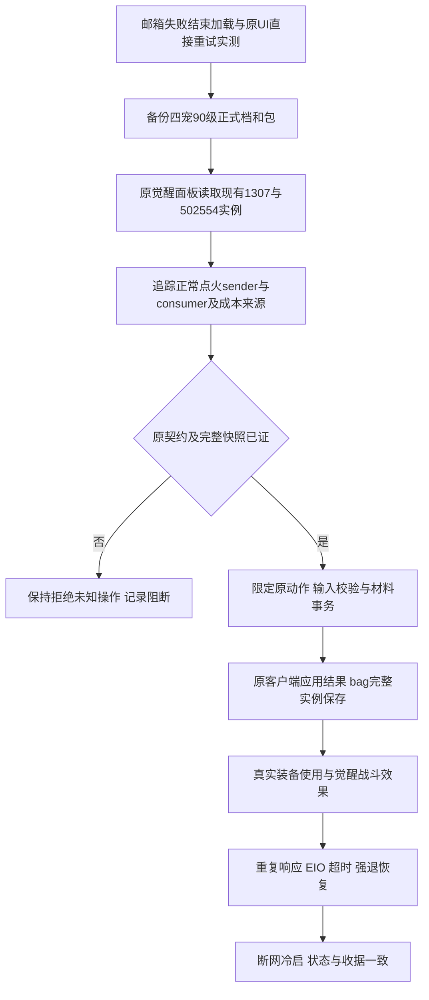

# 15.7.2 下一项高级养成系统计划

## V3 当前优先级与门禁

2026-10-14 用户V3需求把真灵设为P0主线，装备觉醒改为P1只读契约副线；下方原“首选觉醒”排序仅保留为先前工程建议。本轮已完成[基线核查](zmxol-offline-v3-baseline.md)、[真灵逐ID映射](zmxol-offline-true-spirit-resource-map.md)、[对象评分](zmxol-offline-true-spirit-selection.md)及[觉醒契约](zmxol-offline-awakening-contract.md)。

下一步首选9045原融合实例/serializer/权威结果/原子存档补证；四项硬门禁缺失，尚无可实施对象。副线已查明觉醒cmd202–205/sender/cost/result分支，费用概率仍UNKNOWN。禁止按教学成本或其他版本补值。质量门禁另发现原稳定包间歇SDK SecurityException，修复源的外置设备验证与签名APK基线分开记录，见[V3报告](zmxol-offline-v3-report.md)。

## 前阶段计划（历史）

更新时间：2026-10-14。选择范围为两个原APK、15.7.2配置/native及validation3实测。此前稳定性新完整包安装冷启记录已存在，旧“待冷启”文字已失效；它仍不保证后续每次启动无SDK异常。以下培养功能未实施。

**首选装备觉醒的常规培养闭环**：使用已经真实获得、嵌石并冷启保留的虬龙棍1307与Lv2法术灼烧石502554，完成原UI非教学的下一次点火/培养、原属性应用、实际战斗、保存及冷启。不把17步教学的免费成本当成常规成本，不先实现全部套装、符文、仙器和荒古装备。

## 候选比较与优先级

排序是工程判断，不是官方系统重要程度；没有给未知项编造量化评分。

| 次序 | 系统及本轮最小目标 | 客户端/资源证据 | 服务端恢复与依赖 | 能否形成获取→培养→使用→存档 | 复用价值 / 阻断 |
| --- | --- | --- | --- | --- | --- |
| 1 | 装备觉醒：现有虬龙棍/502554继续培养一次 | 原17步UI实测、模型与觉醒面板实际可用；原配置1307、502554、6300004；REQUEST_AROUSAL_FIRE等原标签 | 正常费用、点火失败/随机规则与回包仍须sender/handler契约；既有bag完整实例无需新独立容器 | 获取/嵌入/Lv1→2/保存/冷启已有实测；非教学培养与觉醒战斗效果待验证 | 最接近真实完整闭环；推广嵌入实例、材料扣除、失败重试和事务证据 |
| 2 | 普通法宝：现有宣花葫芦500001原升级路径 | r10原合成、r11真实捕宠/冷启；compose502301本地合成，500001实例实际在bag | upgrade_type0的sender、费用、成长/技能投影未证；不能借用阴阳二气瓶表 | 获取/使用/保存已有，原升级尚未核定；不是仙器法宝 | 后续可复用法宝完整实例/消耗；原升级契约是准入门禁 |
| 3 | 仙器：6900001固定候选铸魂→一项升阶→装备 | 原cmd534 sender/消费函数、type12工厂/serializer、成本表；候选1320已明确 | stunt_info按global_item_id绑定；随机词条/继承算法、辅助保存与着装特效闭包UNKNOWN | 尚无任何仙器真实闭环；固定物品候选不等于固定全部属性 | 真实资产交易价值高；禁止空ACK或图标占位对象 |
| 4 | 真灵：单只原资源完备对象→一次培养→合体 | 46配置，cmd457–470等原路由；原工厂/合体技能代码在 | 独立true_spirit_bag目前不被根白名单接受；完整serializer/唯一ID/融合规则未知；27/46基础资源两包缺 | 普通宠物252的成功不能替代真灵；未验证拥有、培养、合体、冷启 | 待独立容器与资源闭包后推进；不得固定一只对象伪装原融合 |
| 5 | 灵物：原灵物获取→培养→使用 | 原灵物900038介绍自然完成；培养/通灵/空战配置和协议线索在 | 509100原动画两包缺，现有509135仅预览兼容；拥有/成长存档模块UNKNOWN；空战目录空 | 教学通过不是获得物品；培养/飞行/空战均未验 | 下一阶段先找合法资源、字段和产出；不继续靠预览替代推完成 |

高级宠物喂养/八卦可并行补证但不是首项：504100邮件入包已验，实际正式培养消耗未验；900504200八卦仅offered、尚未穿戴。圣佛邪君252为显式60级Mock赠品，不是自然进化或融合已恢复。

## 首选的可核验依据

- 原 `equip[1307]` 是悟空虬龙棍、type12、grade6、equip_type0；配置描述它为可进阶魂器武器。不能把它称为已经恢复的仙器。
- 原 `arousal_stone[502554]` 是法术灼烧武器觉醒石，type11、不堆叠；关联地图技能 `arousal_skill_id_map=6300004`、PK技能6300024。原 `arousal_skill[6300004]` 是 `ATTACK_WITH_EXTRA_DAMAGE_MP_BY_PERCENTAGE`，表内概率0.1、基值0.03、delta0.01、cd1、bTakeEffectOnPk0。**仅是配置值，实际等级计算、触发顺序、伤害与服务端规则没有因为表在就验证通过。**
- [觉醒前快照](../artifacts/zmxol-offline/acceptance-20261014/awaken-before.json)、[原教学后快照](../artifacts/zmxol-offline/acceptance-20261014/awaken-after-guide.json)、[教学完成截图](../artifacts/zmxol-offline/acceptance-20261014/awaken-guide-complete.png)记录原17步操作：获得虬龙棍、购买教学材料、觉醒、嵌入Lv1石、两次点火至Lv2、原完成保存。装备A5=4413，C4第一槽嵌入502554/A5=4415、C2=2/C3=100，另有502502/A5=4414；角色保持90。A5是实例身份，不是配置ID。
- 原协议索引确有 `REQUEST_AROUSAL_FIX_STONE/FIRE/CHARGE_ENERGY/OPEN_AROUSAL_SLOT`。这里只确认标签存在；**命令号、参数类型、handler与成功/失败回包尚未形成契约，不能猜填。**
- 最新冷启完整存档字节相同证明上述保存的稳定性，但没有证明虬龙棍已在战斗中触发觉醒技能。此前700002胜利主要验宠物，不用它替代装备特效验收。

## 依赖图与最小改造边界

当前没有证据说明架构必须整体重写。已有原生物品工厂/完整bag、原SAVE、原子persist、限定奖励收据可沿用，但 mail、lottery、商城及合成的业务契约不同，不能统一成无条件“生成物品＋成功”。只有正常动作需要独立模块且被 `validateSaveUpdate` 拒绝时，先核loader/serializer/schema，然后**限定一个模块和一个动作**补校验/投影/事务；不能全面放开根白名单。具体奖励机制评估见本轮独立评估文档和[既有架构评审](zmxol-offline-architecture-review.md)。

## 缺失资源与证据缺口

| 范围 | 当前状态 | 下一步 |
| --- | --- | --- |
| 首选1307、502554、觉醒教学面板 | 已实测可显示和完成原教学，未发现该窄范围缺项；尚未枚举全部动态资源 | 记录实际loader路径、atlas纹理、技能触发动画；真实路径缺项才从原APK逐bytes补齐 |
| 所有其他觉醒石/觉醒技能 | 资源闭包及常规运行UNKNOWN | 不计入首项完成；分石/技能/角色建立独立证据 |
| 正常点火费用/概率/失败、充能与槽位规则 | UNKNOWN；教学免费不能替代 | 首先核正常sender/handler、配置读取和预览/提交区别；找不到权威计算时明确阻断 |
| 普通法宝升级表 | magic_upgrade_config/upquality仅500027–29阴阳二气瓶，500001使用upgrade_type0 | 不把已有表套到葫芦；追它的原经验路径。500027捕捉/点化依赖真灵，不能选它规避依赖 |
| 真灵 | 仅新原包9043–45三组；旧包16候选，余27基础组缺 | 一个候选也要验证完整atlas分页、合体/子弹资源；未验证不复制盲补 |
| 仙器/器灵 | fairy_armor_effects新版空/旧包105候选；器灵15具名引用缺10、器灵子弹族空 | 区分普通仙器与器灵；逐动态引用闭包，不替代原模型 |
| 灵物 | 509100.skel两包缺；artifact_spirit/air_combat目录空 | 现有预览兼容不算原资源恢复，不作为空战实现依据 |

## 分阶段执行与准出标准

1. **S0 基线保护。** 保存并核验角色90、火丸4399、正式宠物4400出战、调试宠物4401/4402及现有装备/邮件收据。备份私有files/shared_prefs、可读取、hash、权限600；不覆盖两个原APK、历史包和官方存档。邮箱本轮修复必须真实EIO后不重启可重试、仅领取一次，才能继续。
2. **S1 原正常契约。** 从原面板进行只读预览/选项检查；核准确sender命令、tag、参数、完整实例ID、预览与提交、成本表/本地计算、回包成功/失败处理、dirty位、全SAVE/冷启loader。产出一个契约文件及脱敏调用证据。未证常规成本/随机规则时不执行资产扣除，不把教学费用或自定概率当原版；必要时暂停此分支并转第二候选补证。
3. **S2 最小实现。** 若原native已经本地计算并通过原SAVE，只补当前桥接所缺的精确动作/失败结束；若有权威结果依赖，只实现已证一条路线。按实例而非配置ID定位，校验角色/归属/当前Lv/槽位/材料，保持原物品完整未知字段；不足材料、非法槽位、陈旧实例与超限直接失败。奖励/消耗和原native应用须有确定提交点，不能先ACK后落盘。
4. **S3 自动化。** 新正常、材料不足/边界、无匹配实例、非法槽位/上限、同响应重放、超时/EIO无扣除、提交中强退恢复各留一个有业务依据的断言；快照回环保留未修改字段与四宠档。与既有746基线、24邮件助手＋16诊断独立记录，新总数不能照抄。
5. **S4 真实UI闭环。** 常规面板正确显示原Lv2和材料成本→原培养成功或原合法失败→材料/货币变化与契约一致→原装备穿戴/面板→实际战斗觉醒效果→离场结算→冷启数据相同。如果原培养随机，成功和失败都按真实响应验证，不保证一次升Lv3；不得为了验收改中奖规则。只用Mock邮件发真实材料，标清调试获取，不伪装原副本自然掉落。
6. **S5 安全及回归。** 同一正常动作不能重复扣材料或产实例；领取中/保存中退出没有半事务；错误状态结束允许同进程重试；断网冷启；90级与原火丸及4400模型/技能/出战保持；灵物教学不回归、不伪造completeguide。新APK必须签名/CRC/原资源bytes/包内脚本hash，命名新版本，保留validation3。

**完成标准**是这条非教学“获取已有真实装备→常规培养一次→实际效果→存档冷启”的可审计闭环，不是“全部装备觉醒/仙器/真灵/全内容恢复”。未验证真机、其他觉醒石、所有角色或随机公式时明示范围，不扩张结论。
